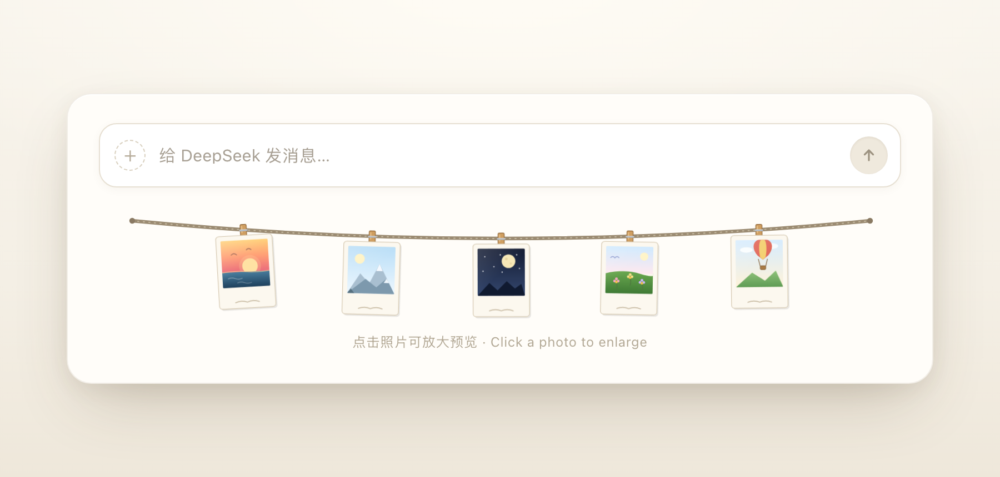

# SnapLine

> A clothesline of polaroid photos hanging under the DeepSeek Harness message composer.

[中文](README.md) · **English**

[](https://github.com/LMhuo/ds-snap-line/actions/workflows/ci.yml)
[](LICENSE)
[](package.json)
[](https://github.com/deepseek-ai)

SnapLine is a UI bundle for [DeepSeek Harness](https://github.com/deepseek-ai). It draws a gently sagging clothesline just under the chat composer, hung with a row of polaroid photos that sway in the breeze. Five hand-drawn illustrations ship by default; drop your own images into `photos/` and they replace the illustrations within seconds, no restart needed.



## Table of contents

- [Features](#features)
- [Install](#install)
- [Use your own photos](#use-your-own-photos)
- [How it works](#how-it-works)
- [Development](#development)
- [Compatibility](#compatibility)
- [FAQ](#faq)
- [Contributing](#contributing)
- [Changelog](#changelog)
- [License](#license)

## Features

- **Two places, one artwork**: hangs in the conversation's `conversation.composer.dock` slot (tight under the composer, never covering controls) and on the blank New Session hero;
- **Five built-in illustrations**: the line is never empty when `photos/` has no images;
- **Your own photos**: `.jpg` `.jpeg` `.png` `.webp` `.gif` `.avif`, natural filename order, live refresh within five seconds after adding, removing or replacing files;
- **Adaptive layout**: up to six photos, evenly sampled when there are more; the more photos, the tighter they sit, each with its own tilt and sway rhythm;
- **Restrained interaction**: hovering gives a photo a small nudge that settles back; clicking opens a lightbox. Only CSS `:hover`, `transform` and a `react-dom` portal — no JS listeners, no extra re-renders;
- **Respects system preferences**: `prefers-reduced-motion` disables the sway animation;
- **Zero runtime dependencies**: plain ESM, no build step; `react` / `react-dom` come from the Harness module table;
- **Photos never leave your machine**: the Host half serves them over the Harness web server's same-origin route; the plugin makes no external requests.

## Install

SnapLine is a Harness bundle, so installation is done by an agent inside Harness through `plugin_manager`.

### Option 1: let the Harness agent install it (recommended)

Send the repository URL to the Harness agent and ask it to install the bundle with `plugin_manager`'s `install_bundle`:

```text
https://github.com/LMhuo/ds-snap-line.git
```

The `github:Lhuo/ds-snap-line` shorthand works too. DSH installs it into the current profile with pnpm, then composes the Host half from `dsh.bundle.patch` and loads the Client half from `dsh.client`.

When it finishes, the plugin appears in Harness's plugin list (the bundle list in `~/.dsh/profiles/<profile>/package.json`) and starts rendering under the composer.

### Option 2: clone locally, then install (best for development)

```bash
git clone https://github.com/LMhuo/ds-snap-line.git
```

Then ask the Harness agent to install that directory's **absolute path** with `install_bundle`. It writes a `link:` dependency into the current profile's `package.json` and adds it to the bundle list — no manual profile editing.

### Option 3: npm (not published yet)

The package name is reserved as `snap-line`. Once published, `install_bundle` can take that name; until then use option 1 or 2.

### Disable and remove

- Toggle the plugin off in Harness's plugin settings; or
- Ask the agent to call `plugin_manager`'s `set_bundle` (disable / enable) or `remove_bundle` (remove).

## Use your own photos

The photo folder is **`photos/` inside the plugin package**:

| Install style | Photo folder |
| --- | --- |
| Local directory / `link:` | `photos/` in this repository |
| GitHub / npm install | `~/.dsh/profiles/<profile>/node_modules/snap-line/photos/` |

Drop images in and that's it:

- Sorted by natural filename order (`1.jpg`, `2.jpg`, `10.jpg` — correctly ordered); non-ASCII filenames work too;
- Up to six photos are shown; extras are evenly sampled;
- Added, removed or replaced files show up within five seconds, no restart;
- An empty folder brings back the built-in illustrations.

> **Privacy**: images in `photos/` never enter Git and are never packed into the npm tarball (see `.gitignore` and `files` in `package.json`), so private photos are fine. They are served only by the local Harness port and never uploaded — but any local process that can reach that port can read them.

## How it works

```text
photos/ ── Host half (index.js) ── GET /snap-line/photos.json ──┐
                                                                ├── Client half (client.js)
photos/<name> ── GET /snap-line/photos/<name> ──────────────────┘    └── SVG clothesline + polaroid frames
```

- **Host half** (`index.js`): registers a `kind: 'prefix'` route at `/snap-line` for the photo manifest and the images. `lib/photos.js` is plain Node and rejects path traversal, hidden filenames and unknown media types, so it is unit-testable on its own;
- **Client half** (`client.js`): registers in the `conversation.composer.dock` slot (`order: 2`) and polls the manifest every five seconds, rendering user photos or the built-in illustrations;
- **New Session hero**: the Host renders `conversation.composer.dock` only for an active Session, so the blank hero has just an empty `[data-composer-dock]` container. The Client half also registers `HeroClothesline` on `shell.overlay`, checks every 250 ms for `[data-content-phase="hero"] [data-composer-dock]`, and portals the same clothesline into it via `react-dom`'s `createPortal`, scaled to 2× the measured composer width (capped at 600px). Once a real conversation mounts its dock entry, the hero copy steps aside; if `react-dom` or `shell.overlay` is unavailable it silently skips, leaving the normal dock rendering intact;
- the dock slot is a fit-content flex row, so an SVG with `width: 100%` collapses to its intrinsic 300px — the conversation clothesline stays ~300px wide. The hero copy therefore uses an explicit pixel width instead of `max-width`.

## Development

```bash
npm test       # node --test: photo listing, file route, manifest consistency — 17 tests
npm run check  # syntax check + full test suite
```

No build step and no runtime dependencies. Editing `client.js` hot-reloads the browser half via HMR; editing `index.js` needs the plugin entry to be disabled and re-enabled once.

For local debugging, install this repository as a `link:` bundle (option 2) so edits take effect immediately.

### Repository layout

```text
ds-snap-line/
├── index.js            # Host half: registers the /snap-line prefix route
├── lib/photos.js       # Photo listing / reading / route resource (plain Node, unit-tested)
├── client.js           # Client half: clothesline SVG, slot registration, lightbox
├── cordis.patch.yml    # Host plugin row inserted by the bundle
├── locale/             # English and Chinese display metadata for the plugin manager
├── icon.svg            # Plugin icon
├── photos/             # Your photos (not committed by default)
├── docs/images/        # Static assets such as the README preview
├── test/               # node:test suites
└── .github/workflows/  # GitHub Actions CI
```

## Compatibility

| Item | Requirement |
| --- | --- |
| DeepSeek Harness | 0.2.x (web platform; developed against 0.2.2) |
| Node.js | ≥ 20 (development and tests only; the runtime uses Harness's bundled Node) |
| Plugin shape | bundle (`dsh` field in `package.json` + `cordis.patch.yml`) |

The plugin declares `engines.dsh: ^0.2.0` in `package.json`: a Harness outside that range skips the bundle instead of loading something incompatible. If you need a wider range, the profile's `compatibility.json` supports per-bundle version exemptions.

## FAQ

**I added photos but the clothesline did not change.**
Make sure they are in the `photos/` folder from the table above, then wait five seconds (the polling interval). Check that the extension is supported and the filename does not start with `.` (hidden files are ignored). With more than six photos only six are shown, evenly sampled.

**Are my photos uploaded or published?**
No. They are served by the local Harness web server over a same-origin route; the plugin makes no external requests and never writes photos into Git or the npm tarball.

**Does it block clicks on the composer?**
No. The wrapper is `pointer-events: none`; only the photo frames opt back in for hover and the lightbox click.

**Can I change the number or size of photos?**
Yes — edit `MAX_PHOTOS` (count), `HERO_SVG_WIDTH` (hero width) and `TILTS` / `DELAYS` / `DURATIONS` (tilt and sway rhythm) in `client.js`.

**Does it support dark theme?**
Currently it uses a fixed warm paper palette and does not follow the Harness theme. PRs welcome.

**How do I upgrade?**
Git installs have no version list: ask the agent to `install_bundle` the latest commit again, or `remove_bundle` first and reinstall. Every release is documented in [CHANGELOG.md](CHANGELOG.md).

**Is commercial use allowed?**
Yes, under the MIT license.

## Contributing

- Bugs and feature requests: open an issue with your Harness version, install style and reproduction steps;
- Code: run `npm run check` first so all 17 tests pass, then open a PR;
- The project is also mirrored on [Gitee](https://gitee.com/Lhuo/ds-snap-line); issues are welcome in either place.

## Changelog

See [CHANGELOG.md](CHANGELOG.md).

## License

[MIT](LICENSE) © 2026 Lhuo
