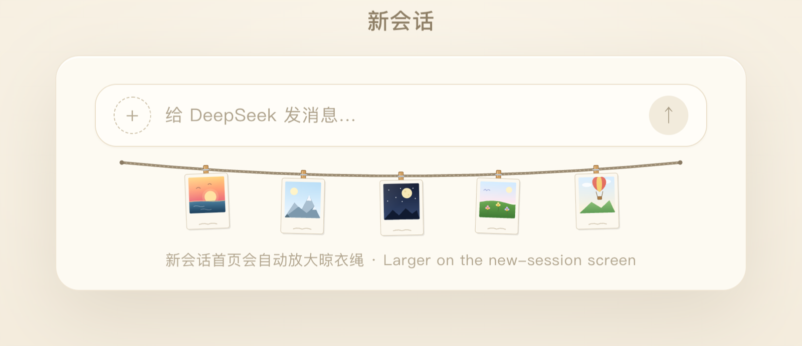
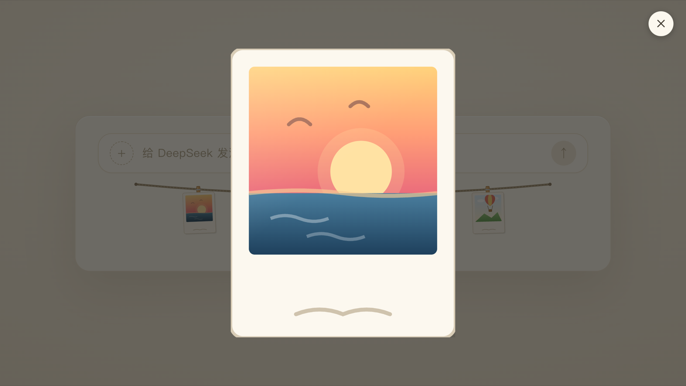

# SnapLine

> A clothesline of polaroid photos hanging under the DeepSeek Harness message composer.

[中文](README.md) · **English**

[](https://github.com/LMhuo/dsh-snap-line/actions/workflows/ci.yml)
[](LICENSE)
[](package.json)
[](https://www.npmjs.com/package/dsh-snap-line)
[](https://github.com/deepseek-ai)

SnapLine is a UI bundle for [DeepSeek Harness](https://github.com/deepseek-ai). It draws a gently sagging clothesline just under the chat composer, hung with a row of polaroid photos that sway in the breeze. Five hand-drawn illustrations ship by default; add a few of your own photos in the installed plugin's detail page and they replace the illustrations within seconds, no restart needed.


## Table of contents

- [Features](#features)
- [Screenshots](#screenshots)
- [Install](#install)
- [Use your own photos](#use-your-own-photos)
- [How it works](#how-it-works)
- [Development](#development)
- [Compatibility](#compatibility)
- [FAQ](#faq)
- [Contributing](#contributing)
- [Changelog](#changelog)
- [License](#license)

## Features

- **Two places, one artwork**: hangs in the conversation's `conversation.composer.dock` slot (tight under the composer, never covering controls) and on the blank New Session hero;
- **Five built-in illustrations**: the line is never empty when the photo folder has no images;
- **Manage your own photos in the plugin detail page**: multi-select add, delete, drag to reorder, and the first six photos hang on the rope; `.jpg` `.jpeg` `.png` `.webp` `.gif` `.avif`;
- **Adaptive layout**: up to six photos; the more photos, the tighter they sit, each with its own tilt and sway rhythm;
- **Original and display copy**: the clothesline and list thumbnails load a few-hundred-KB display copy, while the lightbox loads the original;
- **Restrained interaction**: hovering only uses CSS `:hover` and `transform` to give a photo a small nudge that settles back; clicking opens a lightbox — no mouse listeners, no extra re-renders;
- **Keyboard friendly**: photos are focusable with Tab and open the lightbox with Enter or Space; while the lightbox is open Tab stays on its close button, Escape / backdrop / close button all dismiss it, and focus returns to the photo that opened it;
- **Named for screen readers**: the clothesline, every photo, the lightbox and its close button carry bilingual Chinese/English accessible names;
- **Respects system preferences**: `prefers-reduced-motion` disables the sway animation;
- **Zero runtime dependencies**: plain ESM, no build step; `react` / `react-dom` come from the Harness module table;
- **Photos never leave your machine**: the Host half serves them over the Harness web server's same-origin route; the plugin makes no external requests.

## Screenshots

| New Session hero | Lightbox |
| --- | --- |
|  |  |

## Install

SnapLine is a Harness bundle, so it can be installed from npm, GitHub or a local directory — an agent inside Harness does it through `plugin_manager`.

### Option 1: npm (recommended)

Published on npm as [`dsh-snap-line`](https://www.npmjs.com/package/dsh-snap-line).

- Ask the Harness agent to install `dsh-snap-line` with `plugin_manager`'s `install_bundle`; or
- run this in a terminal:

```bash
dsh plugin --profile <profile> add dsh-snap-line
```

DSH installs it from npm, composes the Host half from `dsh.bundle.patch` and loads the Client half from `dsh.client`. Once the plugin is listed in the community plugin market (awesome-dsh-plugin), it can also be installed by searching for it there.

### Option 2: install from GitHub

Send the repository URL to the Harness agent and ask it to install the bundle with `install_bundle`:

```text
https://github.com/LMhuo/dsh-snap-line.git
```

The `github:LMhuo/dsh-snap-line` shorthand works too. DSH installs it into the current profile with pnpm, then composes the Host half from `dsh.bundle.patch` and loads the Client half from `dsh.client`.

When it finishes, the plugin appears in Harness's plugin list (the bundle list in `~/.dsh/profiles/<profile>/package.json`) and starts rendering under the composer.

### Option 3: clone locally, then install (best for development)

```bash
git clone https://github.com/LMhuo/dsh-snap-line.git
```

Then ask the Harness agent to install that directory's **absolute path** with `install_bundle`. It writes a `link:` dependency into the current profile's `package.json` and adds it to the bundle list — no manual profile editing.

### Disable and remove

- Toggle the plugin off in Harness's plugin settings; or
- Ask the agent to call `plugin_manager`'s `set_bundle` (disable / enable) or `remove_bundle` (remove).

## Use your own photos

Photos are managed in the **installed plugin's detail page**: sidebar **Plugins → Installed plugins → dsh-snap-line**. The photo manager there adds (multi-select), deletes and reorders photos by dragging. Order decides what hangs: **the first six photos are on the rope**, the rest stay in the list.

- Photos live in `$DSH_HOME/dsh-snap-line/photos/` (default `~/.dsh/dsh-snap-line/photos/`), not inside the plugin package, so upgrading the plugin never loses them;
- `.jpg` `.jpeg` `.png` `.webp` `.gif` `.avif`; at most 25MB and 64 megapixels per photo; iPhone HEIC files must be exported to JPEG first;
- The clothesline and list thumbnails load a **display copy** (1280px longest edge, JPEG, usually a few hundred KB); the lightbox loads the **original**;
- The order lives in `.order.json` in the photo folder, display copies in `.display/` (safe to delete, they are rebuilt);
- You can skip the UI: drop images straight into the photo folder and they show up within five seconds; a hand-placed photo without a display copy gets one when you next open the detail page;
- Clearing the photo folder brings the built-in illustrations back.

> **Privacy**: photos stay in the local `$DSH_HOME/dsh-snap-line/photos/` folder and are served by the local Harness port. The plugin makes no external requests, never uploads them, and never writes them into Git or the npm tarball. Any local process that can reach that port can still read them.

> **Upgrading from 1.3.x**: photos left in the old package `photos/` folder are not migrated (an npm install's package folder is already replaced during the upgrade); re-add them in the new detail page. Uninstalling the plugin does not delete the photo folder.

## How it works

```text
$DSH_HOME/dsh-snap-line/photos/
├── <name>                  original
├── .display/<hash>.jpg     display copy (clothesline / thumbnails; the lightbox still uses the original)
└── .order.json             order (the first six hang on the rope)

photo manager (detail page) ── POST /dsh-snap-line/manage ──▶ Host half ──▶ photo folder
Client half (clothesline / lightbox) ◀── GET /dsh-snap-line/photos.json, GET /dsh-snap-line/photos/<name>, GET /dsh-snap-line/display/<name> ── Host half
```

- **Host half** (`index.js`): the `/dsh-snap-line` prefix route (`resource`, GET / HEAD only) serves the photo manifest and the images; a separate `handler` route at `/dsh-snap-line/manage` handles adding, deleting, ordering and display-copy writes. The write side checks same-origin (`Origin` / `Sec-Fetch-Site`) request policy itself, enforces the per-photo size cap and image magic bytes, and writes atomically via temp file + rename. `lib/photos.js` stays plain Node and unit-testable;
- **Client half** (`client.js`): keeps registering `conversation.composer.dock` (`order: 2`) and the `shell.overlay` hero copy, polls the manifest every five seconds, and now also registers the photo manager on the plugin manager page's `plugins.bundle.config` slot (keyed by package name);
- **Original and display copy**: adding a photo generates a display copy in the browser with canvas (1280px longest edge, JPEG quality ≈ 0.82) and uploads it, while the original is stored byte-for-byte; the clothesline and thumbnails use the display copy, the lightbox uses the original; GIF / AVIF display copies use the first frame and keep the original's animation;
- **Order**: `.order.json` holds the filename array; the first six hang on the rope and unlisted photos follow in natural filename order. After a write the client dispatches a window event so the clothesline refreshes immediately, with the five-second poll as fallback;
- **Lightbox**: open it by clicking a photo, or by focusing one with Tab and pressing Enter / Space; Escape, the backdrop or the close button dismiss it, focus returns to the photo, and the page behind it does not scroll while it is open.
- **New Session hero**: the Host renders `conversation.composer.dock` only for an active Session, so the blank hero has just an empty `[data-composer-dock]` container. The Client half also registers `HeroClothesline` on `shell.overlay`, checks every 250 ms for `[data-content-phase="hero"] [data-composer-dock]`, and portals the same clothesline into it via `react-dom`'s `createPortal`, scaled to 2× the measured composer width (capped at 600px). Once a real conversation mounts its dock entry, the hero copy steps aside; if `react-dom` or `shell.overlay` is unavailable it silently skips, leaving the normal dock rendering intact;
- the dock slot is a fit-content flex row, so an SVG with `width: 100%` collapses to its intrinsic 300px — the conversation clothesline stays ~300px wide. The hero copy therefore uses an explicit pixel width instead of `max-width`.

## Development

```bash
npm test       # node --test: photo listing, file route, manifest consistency — all tests
npm run check  # syntax check + full test suite
```

No build step and no runtime dependencies. Editing `client.js` hot-reloads the browser half via HMR; editing `index.js` needs the plugin entry to be disabled and re-enabled once.

For local debugging, install this repository as a `link:` bundle (option 3) so edits take effect immediately.

### Repository layout

```text
dsh-snap-line/
├── index.js            # Host half: read routes at /dsh-snap-line and the /dsh-snap-line/manage write side
├── lib/photos.js       # Photo listing / reading / order / route resource (plain Node, unit-tested)
├── client.js           # Client half: clothesline SVG, slot registration, lightbox, photo manager
├── cordis.patch.yml    # Host plugin row inserted by the bundle
├── locale/             # English and Chinese display metadata for the plugin manager
├── icon.svg            # Vector icon shown in the plugin list
├── screenshots.json    # Market screenshot list (points at docs/images)
├── photos/             # Legacy photo folder, not read since 1.4.0 (see photos/README.md)
├── docs/               # README previews, market screenshots, the PNG icon and docs/adr
├── GLOSSARY.md         # Project glossary
├── test/               # node:test suites
└── .github/workflows/  # GitHub Actions CI
```

## Compatibility

| Item | Requirement |
| --- | --- |
| DeepSeek Harness | 0.2.x (web platform; developed against 0.2.2) |
| Node.js | ≥ 20 (development and tests only; the runtime uses Harness's bundled Node) |
| Plugin shape | bundle (`dsh` field in `package.json` + `cordis.patch.yml`) |

The plugin declares `engines.dsh: ^0.2.0` in `package.json`: a Harness outside that range skips the bundle instead of loading something incompatible. If you need a wider range, the profile's `compatibility.json` supports per-bundle version exemptions.

## FAQ

**I added photos but the clothesline did not change.**
Make sure they are in `$DSH_HOME/dsh-snap-line/photos/` (default `~/.dsh/dsh-snap-line/photos/`), or that the detail page's photo manager lists them, then wait five seconds (the polling interval). Check that the extension is supported, the photo is at most 25MB, and the filename does not start with `.` (hidden files are ignored). With more than six photos only the first six in the order hang on the rope.

**Where did my photos go after upgrading from 1.3.x?**
Photos in the old package `photos/` folder are not migrated — an npm install's package folder is already replaced during the upgrade. Re-add them in the new detail page (for a local `link:` install the files in the repository's `photos/` are still there, so you can pick them directly).

**Are my photos uploaded or published?**
No. They stay in the local photo folder and are served by the local Harness web server over a same-origin route; the plugin makes no external requests and never writes photos into Git or the npm tarball.

**Does it block clicks on the composer?**
No. The wrapper is `pointer-events: none`; only the photo frames opt back in for hover and the lightbox click.

**Can I change the number or size of photos?**
Order decides which six hang — drag them in the detail page. The rope count and hero width are still code constants (`MAX_PHOTOS`, `HERO_SVG_WIDTH`), and `TILTS` / `DELAYS` / `DURATIONS` tune the tilt and sway rhythm.

**Does it support dark theme?**
Currently it uses a fixed warm paper palette and does not follow the Harness theme. PRs welcome.

**How do I upgrade?**
npm installs: check for updates in the plugin market, or ask the agent to `install_bundle` again. Git installs: ask the agent to install the latest commit again, or `remove_bundle` first and reinstall. Every release is documented in [CHANGELOG.md](CHANGELOG.md).

**Can I use it with a keyboard?**
Yes. Photos are focusable with Tab and Enter / Space opens the lightbox; Tab stays on the close button while it is open, Escape closes it, and focus returns to the photo. 

**Is commercial use allowed?**
Yes, under the MIT license.

## Contributing

- Bugs and feature requests: open an issue with your Harness version, install style and reproduction steps;
- Code: run `npm run check` first so all tests pass, then open a PR;
- The project is also mirrored on [Gitee](https://gitee.com/Lhuo/dsh-snap-line); issues are welcome in either place.

## Changelog

See [CHANGELOG.md](CHANGELOG.md).

## License

[MIT](LICENSE) © 2026 Lhuo
