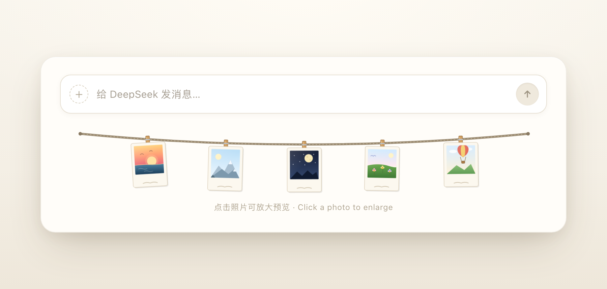
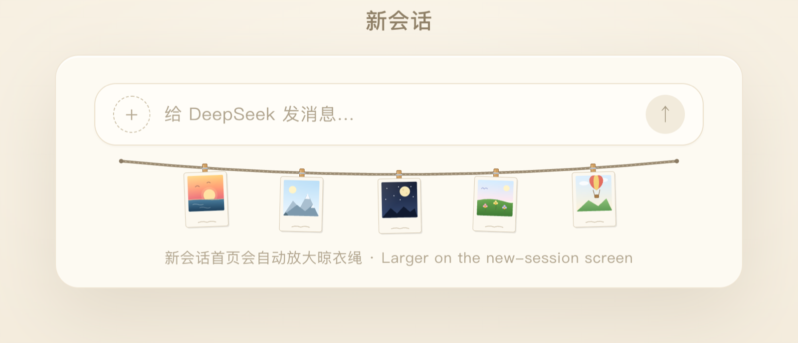
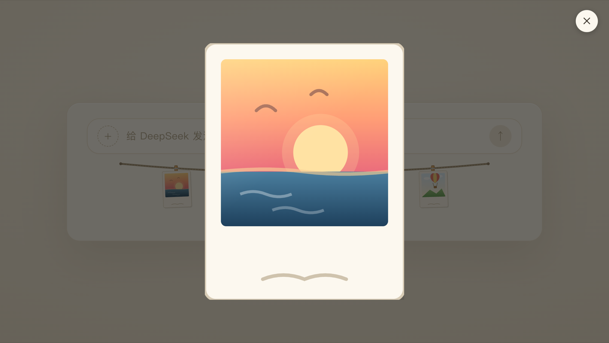

# SnapLine

> 一条挂在 DeepSeek Harness 消息输入框下方的照片晾衣绳。

**中文** · [English](README.en.md)

[](https://github.com/LMhuo/dsh-snap-line/actions/workflows/ci.yml)
[](LICENSE)
[](package.json)
[](https://www.npmjs.com/package/dsh-snap-line)
[](https://github.com/deepseek-ai)

SnapLine 是 [DeepSeek Harness](https://github.com/deepseek-ai) 的界面插件（bundle）。它在聊天输入框下方画一条微微下垂的晾衣绳，夹上一排拍立得照片，照片随风轻轻摆动。默认是五张手绘小画；在已安装插件的详情页里加几张自己的照片，就会换成你自己的照片，几秒内自动刷新，无需重启。



## 目录

- [特性](#特性)
- [截图](#截图)
- [安装](#安装)
- [使用自己的照片](#使用自己的照片)
- [工作原理](#工作原理)
- [开发](#开发)
- [兼容性](#兼容性)
- [常见问题](#常见问题)
- [贡献](#贡献)
- [更新日志](#更新日志)
- [License](#license)

## 特性

- **两个位置都会出现**：既挂在会话页的 `conversation.composer.dock` 插槽里（紧贴输入框下方、不遮挡操作），也出现在新会话首页的空白 Hero 里；
- **自带五张手绘插画**：照片目录为空时使用内置插画，不会出现空荡荡的绳子；
- **在插件详情页管理自己的照片**：多选添加、删除、拖动排序，前 6 张上绳；支持 `.jpg` `.jpeg` `.png` `.webp` `.gif` `.avif`；
- **排版自适应**：最多显示 6 张；照片越多排得越密，每张有自己的倾斜角度与摆动节奏；
- **原图与显示版分离**：晾衣绳和列表缩略图加载几百 KB 的显示版，点开灯箱才加载原图；
- **交互克制**：悬停只靠 CSS `:hover` 与 `transform` 让照片轻轻晃一下再回正，点击打开灯箱预览，没有鼠标监听、没有多余重渲染；
- **键盘友好**：照片可以用 Tab 聚焦，Enter / 空格打开灯箱；灯箱打开后 Tab 被约束在关闭按钮上，Esc、点击背景或关闭按钮都能退出，关闭后焦点回到打开它的照片；
- **读屏器可读**：晾衣绳、每张照片、灯箱与关闭按钮都有中英双语的无障碍名称；
- **尊重系统偏好**：`prefers-reduced-motion` 开启时不做摆动动画；
- **零运行时依赖**：纯 ESM、无构建步骤，`react` / `react-dom` 复用 Harness 内置模块；
- **照片不出本机**：Host 半通过 Harness web server 的同源路由提供图片，插件不发起任何外部请求。

## 截图

| 新会话首页 | 灯箱预览 |
| --- | --- |
|  |  |

## 安装

SnapLine 是 Harness 的 bundle 插件，可以走 npm、GitHub 或本地目录；安装由 Harness 里的 Agent 通过 `plugin_manager` 完成。

### 方式一：npm（推荐）

已发布到 npm：[`dsh-snap-line`](https://www.npmjs.com/package/dsh-snap-line)。

- 让 Harness Agent 用 `plugin_manager` 的 `install_bundle` 安装 `dsh-snap-line`；
- 或在终端运行：

```bash
dsh plugin --profile <profile> add dsh-snap-line
```

DSH 会从 npm 装好，并按 `dsh.bundle.patch` 组合 Host 半、按 `dsh.client` 加载 Client 半。收录到社区插件市场（awesome-dsh-plugin）后，也可以直接在 Harness 的插件市场里搜索安装。

### 方式二：从 GitHub 安装

把仓库地址发给 Harness Agent，并让它用 `install_bundle` 安装：

```text
https://github.com/LMhuo/dsh-snap-line.git
```

也支持 `github:LMhuo/dsh-snap-line` 简写。DSH 会先用 pnpm 把它装进当前 profile，再按 `dsh.bundle.patch` 组合 Host 半、按 `dsh.client` 加载 Client 半。

安装成功后，插件会出现在 Harness 的插件列表（`~/.dsh/profiles/<profile>/package.json` 的 bundle 列表）里，并自动在输入框下方生效。

### 方式三：本地克隆后安装（开发 / 调试推荐）

```bash
git clone https://github.com/LMhuo/dsh-snap-line.git
```

然后让 Harness Agent 用 `plugin_manager` 的 `install_bundle` 安装这个目录的**绝对路径**。`install_bundle` 会在当前 profile 的 `package.json` 中写入 `link:` 依赖并加入 bundle 列表，无需手动改 profile 文件。

### 停用与卸载

- 在 Harness 的插件设置里停用；
- 或让 Agent 调用 `plugin_manager` 的 `set_bundle`（停用 / 启用）与 `remove_bundle`（移除）。

## 使用自己的照片

照片在**已安装插件的详情页**里管理：侧栏 **Plugins → Installed plugins → dsh-snap-line**，详情页里的照片管理器可以多选添加、删除、拖动排序。排序决定哪 6 张上绳：**前 6 张挂在绳上**，其余照片留在列表里。

- 照片存放在 `$DSH_HOME/dsh-snap-line/photos/`（默认 `~/.dsh/dsh-snap-line/photos/`），不在插件包内，升级插件不会丢照片；
- 支持 `.jpg` `.jpeg` `.png` `.webp` `.gif` `.avif`；单张 ≤ 25MB、像素 ≤ 64MP；iPhone 的 HEIC 需要先在相册里导出成 JPEG；
- 晾衣绳和列表缩略图加载的是**显示版**（长边 1280 的 JPEG，通常几百 KB），点开灯箱加载**原图**；
- 顺序保存在照片目录的 `.order.json` 里，显示版保存在 `.display/` 里（删掉可以重建）；
- 不想用界面也可以：直接把图片放进照片目录，5 秒内自动上绳；手动放进去的照片如果没有显示版，打开详情页时会自动补生成；
- 清空照片目录会恢复内置插画。

> **隐私**：照片只保存在本机 `$DSH_HOME/dsh-snap-line/photos/`，由本机 Harness 端口提供；插件不发起外部请求、不上传，也不写进 Git 或 npm 包。能访问该端口的本机进程可以看到这些图片。

> **从 1.3.x 升级**：旧版本放在插件包 `photos/` 里的照片不会自动迁移（npm 安装的包目录在升级时已经被替换），请在新版详情页里重新添加。卸载插件不会删除照片目录。

## 工作原理

```text
$DSH_HOME/dsh-snap-line/photos/
├── <name>                  原图
├── .display/<hash>.jpg     显示版（晾衣绳 / 缩略图用；灯箱仍用原图）
└── .order.json             顺序（前 6 张上绳）

详情页照片管理器 ── POST /dsh-snap-line/manage ──▶ Host 半 ──▶ 照片目录
Client 半（晾衣绳 / 灯箱） ◀── GET /dsh-snap-line/photos.json、GET /dsh-snap-line/photos/<name> ── Host 半
```

- **Host 半**（`index.js`）：`/dsh-snap-line` 前缀路由（`resource`，只处理 GET / HEAD）提供照片清单与图片；另有一个 `handler` 路由 `/dsh-snap-line/manage` 处理添加、删除、排序和显示版写入。写入端自己检查同源（`Origin` / `Sec-Fetch-Site`）、单张大小上限和图片 magic bytes，并用临时文件 + rename 原子写入；`lib/photos.js` 保持纯 Node、可独立单测；
- **Client 半**（`client.js`）：照旧注册到 `conversation.composer.dock` 插槽（`order: 2`）与 `shell.overlay` 里的 Hero 版本，每 5 秒轮询一次清单；另外向插件管理页的 `plugins.bundle.config` 插槽注册照片管理器（按包名 keyed）；
- **原图与显示版**：添加照片时在浏览器里用 canvas 生成显示版（长边 1280、JPEG 质量约 0.82）再上传，原图按原字节保存；晾衣绳和缩略图用显示版，灯箱用原图；GIF / AVIF 的显示版取首帧，原图保留动画；
- **顺序**：`.order.json` 保存文件名数组，前 6 张上绳，没列进去的照片按文件名自然排序排在后面；写完之后客户端发一个窗口事件让晾衣绳立即刷新，5 秒轮询仍然作为兜底；
- **灯箱**：点击照片（或 Tab 聚焦后按 Enter / 空格）打开；Esc、点击背景或关闭按钮退出，关闭后焦点回到打开它的照片，灯箱打开期间背景不滚动。
- **新会话首页**：Host 只在有 Session 时渲染 `conversation.composer.dock`，空白 Hero 里只有一个空的 `[data-composer-dock]` 容器。Client 半额外向 `shell.overlay` 注册 `HeroClothesline`，每 250ms 检查页面里是否存在 `[data-content-phase="hero"] [data-composer-dock]`，若有则通过 `react-dom` 的 `createPortal` 把同一条晾衣绳画进该容器，并按量到的输入框宽度放大到 2 倍（600px 封顶）。进入正常会话、dock 版出现后自动让位，不会重复显示；拿不到 `react-dom` 或 `shell.overlay` 时静默跳过，不影响 dock 渲染；
- dock 插槽本身是 fit-content 的 flex 行，SVG 的 `width: 100%` 会退回固有 300px，所以会话页晾衣绳一直是 300px 左右；Hero 版因此使用显式像素宽度，而不是改 `max-width`。

## 开发

```bash
npm test       # node --test：照片清单、静态文件路由、清单一致性等全部用例
npm run check  # 语法检查 + 全部测试
```

没有构建步骤，也没有运行时依赖。修改 `client.js` 会通过 HMR 自动刷新浏览器半；修改 `index.js` 后需要在插件设置里停用再启用一次。

本地调试时推荐用上面的「方式三」以 `link:` 方式安装本仓库，这样改代码即时生效。

### 目录结构

```text
dsh-snap-line/
├── index.js            # Host 半：注册 /dsh-snap-line 读路由与 /dsh-snap-line/manage 写入端
├── lib/photos.js       # 照片清单 / 读取 / 顺序 / 路由资源（纯 Node，可单独测试）
├── client.js           # Client 半：晾衣绳 SVG、插槽注册、灯箱、照片管理器
├── cordis.patch.yml    # bundle 插入的 Host 插件行
├── locale/             # 插件管理器中显示的中英文标题与描述
├── icon.svg            # 插件列表里显示的矢量图标
├── screenshots.json    # 插件市场卡片用的截图清单（指向 docs/images）
├── photos/             # 旧照片位置，1.4.0 起不再读取（见 photos/README.md）
├── docs/               # README 预览图、市场截图、PNG 图标与 docs/adr
├── GLOSSARY.md         # 项目术语表
├── test/               # node:test 测试
└── .github/workflows/  # GitHub Actions CI
```

## 兼容性

| 项目 | 要求 |
| --- | --- |
| DeepSeek Harness | 0.2.x（Web 平台；开发验证于 0.2.2） |
| Node.js | ≥ 20（仅开发与测试需要，运行时使用 Harness 内置 Node） |
| 插件形态 | bundle（`package.json` 的 `dsh` 字段 + `cordis.patch.yml`） |

插件在 `package.json` 的 `engines.dsh` 中声明 `^0.2.0`：Harness 低于该范围时会跳过加载，避免在不兼容的版本上出错。需要更宽的兼容性时，可以用 profile 的 `compatibility.json` 做版本豁免。

## 常见问题

**放了照片但晾衣绳上没有变化？**
先确认照片在 `$DSH_HOME/dsh-snap-line/photos/`（默认 `~/.dsh/dsh-snap-line/photos/`），或者能在详情页的照片管理器里看到它；再等 5 秒（轮询间隔）。检查扩展名是否在支持列表内、单张是否超过 25MB、文件名是否以 `.` 开头（隐藏文件会被忽略）。超过 6 张时只有顺序里的前 6 张上绳。

**从 1.3.x 升级后原来的照片去哪了？**
旧版本放在插件包 `photos/` 里的照片不会自动迁移 —— npm 安装的包目录在升级时已经被替换。请在新版详情页里重新添加（本地 `link:` 安装在仓库 `photos/` 里的文件还在，可以直接选它们）。

**照片会被上传或公开吗？**
不会。照片只保存在本机照片目录，由本机 Harness web server 的同源路由提供，插件不发外部请求，也不会把照片写进 Git 或 npm 包。

**会挡住消息输入框的点击吗？**
不会。外层容器是 `pointer-events: none`，只有照片本身恢复指针事件，用于悬停与点击灯箱。

**可以改照片数量或尺寸吗？**
顺序决定哪 6 张上绳，在详情页里拖动即可。上绳数量和 Hero 版宽度仍是代码常量（`MAX_PHOTOS`、`HERO_SVG_WIDTH`），倾斜与摆动节奏在 `TILTS` / `DELAYS` / `DURATIONS` 里调。

**支持深色主题吗？**
目前使用固定的暖色纸张配色，不随 Harness 主题切换；欢迎提交 PR。

**怎么升级到新版本？**
npm 安装：在插件市场里检查更新，或让 Agent 重新用 `install_bundle` 安装；Git 安装：让 Agent 重新安装最新提交，或先 `remove_bundle` 再安装。每个版本的变更见 [CHANGELOG.md](CHANGELOG.md)。

**可以用键盘操作吗？**
可以。照片可以用 Tab 聚焦，Enter / 空格打开灯箱；灯箱打开后 Tab 被约束在关闭按钮上，Esc 关闭，关闭后焦点回到照片。

**可以商用吗？**
可以，MIT 协议。

## 贡献

- 发现 bug、想要新功能：欢迎开 issue，尽量附上 Harness 版本、安装方式与复现步骤；
- 提交代码：先 `npm run check` 保证全部测试通过，再发起 PR；
- 本项目同时镜像在 [Gitee](https://gitee.com/Lhuo/dsh-snap-line)，两边都可以提 issue。

## 更新日志

见 [CHANGELOG.md](CHANGELOG.md)。

## License

[MIT](LICENSE) © 2026 Lhuo
